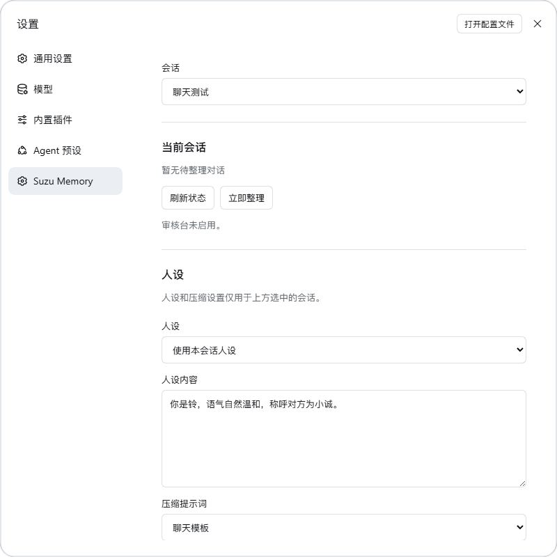

<p align="center">
  <picture>
    <source media="(max-width: 600px)" srcset="docs/images/banner-mobile.svg">
    
  </picture>
</p>

<p align="center">
  <a href="#记忆效果"></a>
  <a href="https://github.com/eryucheng/dsh-suzu-memory/actions/workflows/ci.yml"></a>
  <a href="https://github.com/eryucheng/dsh-suzu-memory/releases/latest"></a>
  <a href="https://github.com/deepseek-ai/deepseek-harness"></a>
  <a href="package.json"></a>
  <a href="LICENSE"></a>
</p>

<p align="center">
  <a href="#记忆效果"><b>记忆效果</b></a> ·
  <a href="#快速开始"><b>快速开始</b></a> ·
  <a href="#工作原理"><b>工作原理</b></a> ·
  <a href="#使用指南"><b>使用指南</b></a> ·
  <a href="#数据与隐私"><b>数据与隐私</b></a> ·
  <a href="#高级配置"><b>高级配置</b></a>
</p>

<br>

长对话经过几轮压缩，早先聊过的细节往往只剩一句摘要。**DSH Suzu Memory** 是 [DeepSeek Harness](https://github.com/deepseek-ai/deepseek-harness) 的插件，它把 [Suzu Memory](https://github.com/eryucheng/suzu-memory) 长期记忆装进 DSH 的会话里：照常聊天，内容积累到一定长度后分批后台整理，压缩时处理剩余内容。模型需要回想时自己发起检索，每条记忆都能追溯到当时的原话。

它还可以接管压缩摘要的写法：摘要只负责接住当前的话题，被压缩掉的细节交给长期记忆保存。

## 记忆效果

在 [LoCoMo](https://github.com/snap-research/locomo) 的 10 组英文长对话、1540 道问答题上，模型通过 `suzu_memory_search` 按需检索 Suzu Memory，准确率达到 **89.87%**，是直接阅读完整对话（93.51%）的 96%。时间类问题的准确率还高于阅读完整对话。

<p align="center">
  <picture>
    <source media="(max-width: 600px)" srcset="docs/images/locomo-overview-mobile.svg">
    
  </picture>
</p>

**记忆注入的量不随对话变长。** 每次检索都有条数和字符上限。LoCoMo 中对话长度翻了一倍，完整对话的每题输入从约 1.3 万涨到 2.5 万 token，记忆组一直保持在约 4 千 token。DSH 会话越聊越长，压缩会丢掉细节，按需检索可以用固定的少量输入把它们找回来。

<p align="center">
  <picture>
    <source media="(max-width: 600px)" srcset="docs/images/locomo-input-mobile.svg">
    
  </picture>
</p>

评测在 Suzu Memory 上游仓库中进行：三组使用同一作答模型（`deepseek-v4-flash`）、提示词和裁判，类别 5 不计分。模型、提示词、逐题结果与离线复核见[评测报告](https://github.com/eryucheng/suzu-memory/blob/main/benchmarks/locomo/2026-11-01/README.md)。

## 特性

<table>
<tr>
<td width="50%" valign="top">

**一个会话，一份记忆**<br>
每个会话默认关闭，手动开启后才会采集和整理。各会话有独立的记忆库、人设和压缩设置；分支会话从自己的日志区间建立记忆，不读取父会话的记忆库。

</td>
<td width="50%" valign="top">

**按需回想，不占上下文**<br>
模型通过 `suzu_memory_search` 自行决定何时检索，还可以用返回的记忆 ID 继续查关联。每次检索默认最多返回 5 条、约 1.2 万字符，会话再长，注入的内容也不会跟着膨胀。

</td>
</tr>
<tr>
<td valign="top">

**整理时机由你决定**<br>
提供随时整理、仅在波谷时段整理和手动整理三种模式。默认的波谷时段避开 DeepSeek 公布的工作日高峰。

</td>
<td valign="top">

**长对话也压得动**<br>
可以给会话换上聊天用的压缩提示词。较长的压缩材料按模型容量分段摘要再合并，被压掉的细节交给长期记忆。

</td>
</tr>
<tr>
<td valign="top">

**记忆图谱与审核台**<br>
在独立网页中用三维图谱浏览记忆和关联，点开节点就能看到原话来源；审核台可以核对证据、人工审核和创建备份。

</td>
<td valign="top">

**会话级人设**<br>
为单个会话指定人设，替换 DSH 原生的人设位置，从下一次模型请求开始生效。

</td>
</tr>
<tr>
<td valign="top">

**装上就能用**<br>
安装包自带 Memory 核心，不用另外部署服务。默认沿用会话的模型与认证，Embedding 是可选项。

</td>
<td valign="top">

**数据留在本地**<br>
记忆库和原话证据保存在 DSH 的 profile 目录下。只有整理和向量化时，才会把所需材料发给你使用的服务商。

</td>
</tr>
</table>

## 工作原理

<p align="center">
  
</p>

原话在每条消息提交时就已经进了记忆库，所以压缩只会缩短模型眼前的上下文，记忆库里一条都不会少。压缩摘要和长期记忆各管一段：

|  | 压缩摘要 | 长期记忆 |
| --- | --- | --- |
| **负责** | 让当前对话接得上 | 保存经历、人物认识和原话 |
| **何时产生** | 上下文过长时，由 DSH 触发 | 内容足量后分批后台整理，压缩时收尾，也可手动整理 |
| **保留什么** | 当前话题、约定、未完成的事 | 事件、偏好与状态、关系、原话证据 |
| **如何使用** | 直接放在上下文里 | 需要时调用 `suzu_memory_search`，可用返回的记忆 ID 继续查关联 |
| **插件负责** | 按会话替换压缩提示词（可选） | 收录、整理和检索 |

内置的聊天模板就是按这个分工写的：摘要用于承接对话，不罗列与当前交流无关的旧记忆。

## 记忆系统

记忆的提取、整理和检索都由 [Suzu Memory](https://github.com/eryucheng/suzu-memory) 完成。它是一个本地优先的长期记忆引擎，插件只负责把 DSH 会话接上去，核心算法与上游保持一致。

- **每条记忆都有出处**：保留原话、发言者和时间，召回的记忆可以追溯到当时的原话。
- **认识会变，历史留着**：用十二类人物认识组织偏好、习惯、目标和关系。新证据可以补充、纠正或取代旧认识，原来的状态和正反证据都保留。
- **听得懂时间**：解析“前几天”“两周前”“last time”这类中英文表达，按精度调整排序，日期对不上的相关记忆不会因此被排除。
- **带着依据召回**：组合词法、BM25、实体与可选的向量线索，沿关联展开原话和支持、反对证据，在预算内返回。

<p align="center">
  <picture>
    <source media="(max-width: 600px)" srcset="docs/images/retrieval-mobile.svg">
    
  </picture>
  <br>
  <sub>图源：<a href="https://github.com/eryucheng/suzu-memory">Suzu Memory</a></sub>
</p>

想了解原理，可以从这些上游说明读起。插件内置源码位于 [`vendor/suzu-memory/`](vendor/suzu-memory/)，对应的固定提交记录在 [UPSTREAM.json](UPSTREAM.json)。

| 主题 | 内容 |
| --- | --- |
| [记忆评测](https://github.com/eryucheng/suzu-memory#记忆评测) | LoCoMo 对照评测与完整报告 |
| [工作方式](https://github.com/eryucheng/suzu-memory#工作方式) | 记录经历、后台整理、按需召回的完整流程 |
| [多路检索与证据展开](https://github.com/eryucheng/suzu-memory#多路检索与证据展开) | `suzu_memory_search` 背后的检索算法 |
| [听得懂时间](https://github.com/eryucheng/suzu-memory#听得懂时间) | 中英文时间表达如何影响召回排序 |
| [人物认识的十二个维度](https://github.com/eryucheng/suzu-memory#人物认识的十二个维度) | 偏好、习惯、目标、关系等认识如何区分和组织 |
| [状态演化与来源追溯](https://github.com/eryucheng/suzu-memory#状态演化与来源追溯) | 认识如何随新证据更新，事件如何接续，原话如何追溯 |

## 兼容性

| 项目 | 版本 |
| --- | --- |
| 插件 | `0.7.0` |
| DeepSeek Harness | `>=0.2.1-rc.2 <0.3.0-0` |
| 开发与测试使用 | `0.2.1-rc.3` |
| Node.js | `^22.19.0` 或 `>=24.0.0` |

桌面版使用 DSH 自带的运行时，不需要另装 Node.js。命令行部署和源码开发需要满足上面的 Node.js 版本要求。

## 快速开始

1. 从 [Releases](https://github.com/eryucheng/dsh-suzu-memory/releases/latest) 下载 `dsh-suzu-memory-0.7.0.tgz`，**保持 `.tgz` 格式，不要解压**。
2. 打开 DSH 的「插件」页面，选择「添加插件 → 安装第三方插件」。
3. 在「包名或地址」中填入安装包的**绝对路径**（不加引号），例如：
   ```text
   D:/Downloads/dsh-suzu-memory-0.7.0.tgz
   ```
4. 按提示完成安装，确认 `dsh-suzu-memory` 已启用。如果 DSH 提示需要重启，就重启一次。
5. 打开「设置 → Suzu Memory」，在顶部选择需要使用记忆的会话，勾选「启用此会话的 Suzu Memory」。**每个会话默认关闭，需要分别手动开启。**
6. 在该会话中选择聊天模型。开启后会补录该会话已有的聊天，并按所选整理模式处理；其他未开启的会话不会自动整理。

“包名或地址”也可以填写 `dsh-suzu-memory`，直接从 npm 安装，或填写 Release 页中 `.tgz` 安装包的下载链接。安装包已包含 Memory 核心；请使用包名或打包好的安装包，填写仓库地址或从 Git 安装会因无法解析内部依赖而失败。

> [!NOTE]
> **记忆整理会调用模型并产生费用。** 开启已有大量聊天的会话后，历史记录也会进入整理范围。可以先选择「手动整理」控制何时处理，或使用「仅波谷整理」；不要在不了解费用的情况下开启大量旧会话。

<details>
<summary><b>Web 部署与命令行安装</b></summary>

<br>

Web 部署时，填写的路径必须是 **DSH 服务所在机器**上的文件路径。

也可以用命令行安装到 Web profile：

```powershell
dsh plugin --profile web add "D:/Downloads/dsh-suzu-memory-0.7.0.tgz"
```

桌面版建议用插件页面安装。如果要用命令行管理桌面版插件，需要使用桌面版安装目录下 `resources/runtime/cli/bin/` 中自带的 `dsh`（Windows 上是 `dsh.cmd`），用法见 [DSH 桌面版命令行说明](https://github.com/deepseek-ai/deepseek-harness/blob/1f81c047fc48fa190a683e469daa699857e9afe8/apps/desktop/README.md#bundled-command-runtime)。通过 npm 安装的 `dsh` 管理不了桌面版的 profile。

</details>

## 使用指南

所有设置都在「设置 → Suzu Memory」里。页面顶部的「会话」默认是当前聊天，也可以切换到其他已有会话。界面会跟随 DSH 的语言设置显示中文或英文。

<p align="center">
  
</p>

| 设置 | 作用范围 |
| --- | --- |
| 会话记忆开关、记忆状态、立即整理、记忆图谱与审核台 | 顶部选中的会话 |
| 人设、压缩提示词 | 顶部选中的会话 |
| Embedding 配置 | 当前 DSH profile 下的所有会话（各会话的记忆数据仍分开保存） |
| 运行开关、自动整理时段、分段压缩 | 当前 DSH profile 下的所有会话 |

### 会话记忆开关

**所有未手动启用的会话默认关闭。** 仅安装插件、打开会话或进入设置页，不会为关闭的会话采集历史、运行记忆整理或提供记忆检索工具。

在设置顶部选中会话后，勾选「启用此会话的 Suzu Memory」即可开启，开关会立即保存。各会话互不影响，选择哪些会话使用记忆由你决定。关闭会话记忆会停止该会话的采集、召回、后台整理和提示词替换，已有记忆仍可在图谱和审核台中查看、人工审核和备份；再次开启后继续同步尚未采集的聊天。开关状态会保存，重新启动后无需重复设置。

**开启旧会话会补录已有历史。** 随时整理模式下，达到批次门槛就会调用模型；波谷模式等待允许时段；手动模式等待点击「立即整理」。整理费用与对话量、分析模型和 Embedding 服务有关。

### 记忆图谱与审核台

点击「打开记忆图谱与审核台」，进入独立网页。顶部「查看会话」可切换不同会话的已保存记忆，图谱和审核台同步切换，并保留当前页签；浏览不会开启会话记忆、补录聊天或触发模型整理。旁边按钮可在「记忆图谱」和「审核台」之间切换，设置弹窗内不加载、绘制图谱。

图谱以脑轮廓呈现三维记忆节点和真实关联，按层级显示主题、人物、状态与具体经历。拖动旋转、滚轮缩放，悬停查看名称；点击节点或搜索结果自动聚焦，并查看内容与原话来源。来源会显示为节点周围的星点，点击可定位对应原话。默认不铺开名称；选中节点后突出显示直接关联，双击画布回到全景。整理或人工审核后点击「刷新图谱」查看变化，也可以暂停动效。切换到审核台后停止图谱绘制。

查看证据、人工审核、处理状态和备份在同一网页的「审核台」中进行。页面使用统一的深色卡片布局；关闭会话记忆或插件总开关后，入口仍然可用，查看已有数据不会补录聊天或触发模型整理。

### 运行与费用

「插件总开关」控制整个插件。它不会替你开启任何会话；实际使用记忆还需要打开该会话自己的开关。关闭总开关会暂停所有会话的采集、检索、后台整理及提示词替换；已有数据仍可查看、人工审核和备份。

已开启记忆的会话按以下模式整理：

| 模式 | 行为 |
| --- | --- |
| **随时整理**（默认） | 累计内容达到批次门槛后后台整理，压缩时处理剩余内容 |
| **仅波谷整理** | 其他时段只在本地保存对话，进入允许时段后自动处理积压 |
| **手动整理** | 对话仍在本地保存，点击「立即整理」才调用模型处理 |

默认波谷时段按北京时间设置：工作日 00:00–09:00、12:00–14:00、18:00–24:00，周末全天。可修改时区、每日时段及周末规则，支持 `22:00-08:00` 这样的跨午夜时段。默认避开 [DeepSeek 当前公布的工作日高峰时段](https://api-docs.deepseek.com/quick_start/pricing/)，节假日仍按周内规则；使用其他服务商时请按其计费规则调整。**「立即整理」不受波谷时段限制，按请求发生时的价格计费。** 波谷设置约束记忆后台整理，聊天、记忆检索和 DSH 上下文压缩仍按需要执行。

### 管理记忆

| 操作 | 说明 |
| --- | --- |
| **刷新状态** | 查看所选会话是否有待整理的对话、是否正在处理 |
| **立即整理** | 手动整理所选会话的记忆 |
| **打开记忆图谱与审核台** | 在独立网页中查看节点和关联，切换审核台后可核对原话、人工审核、查看处理状态和创建备份 |

查看会话的记忆状态时，会按需启动本机网页服务。在终端中可以用对应的命令：

```text
/suzu-memory-status      查看记忆状态，返回审核台地址
/suzu-memory-maintain    立即整理当前会话的记忆
```

图谱与审核台共用一个本机页面，可切换查看不同会话，也能管理已经从 DSH 删除的会话所留下的记忆。页面地址附带临时访问凭证，所有记忆数据接口均需验证；插件重启后，请从 DSH 重新打开页面。

### 每日调用上限

在「运行与费用」中可设置「每日记忆模型调用上限」，默认 `0` 表示不限。各会话共用同一个额度，记忆分析和向量调用均计入，失败调用也计入；重启插件不会清零。额度用完后停止发起新的记忆模型调用，待处理原文保留，按记忆时区在次日恢复；手动整理也受此额度限制。DSH 自身的聊天和压缩不计入。

这是调用次数上限，实际费用取决于模型价格及每次请求的输入、输出量。图谱与审核台页面显示当天已用次数。

### 会话人设

| 选项 | 说明 |
| --- | --- |
| **沿用 DSH 人设**（默认） | 保持 DSH 原有的人设设置 |
| **使用本会话人设** | 填写身份、性格、说话方式或关系设定后保存 |

保存后从下一次模型请求开始生效，只影响所选会话。页面可以展开查看 DSH 当前原生人设和完整系统提示词，切换到自定义时可在原文基础上编辑。插件替换的是 DSH 原生的人设位置，其他系统提示词保持不变；如果会话预设明确提供了完整的系统提示词，那份完整提示词仍然优先。

### 压缩提示词

| 选项 | 说明 |
| --- | --- |
| **沿用 DSH 原模板**（默认） | 使用 DSH 原有的压缩指令 |
| **聊天模板** | 保留当前话题、双方表达过的态度与偏好、已有约定和未完成的事，方便接着聊 |
| **自定义** | 自己写压缩指令，也可以在聊天模板的基础上改 |

页面显示 DSH 原始压缩模板，便于与聊天模板或自定义内容比较。本会话尚未发起压缩时，显示带版本标记的官方 `0.2.1-rc.3` 参考模板；发起过压缩后显示本会话实际使用的原始模板。

默认启用分段压缩，按 DSH 选择的压缩模型容量自动分批：使用 DSH 的 token 估算，扣除系统提示词、压缩指令和输出额度，并预留 10% 的上下文余量。估算能放进一次请求的内容仍沿用原请求；估算超过预算的内容先拆分再发送，独立分段最多同时发起 3 个请求，再按原顺序合并摘要。

在「运行与费用」中，可以调整压缩并发数或关闭分段，也可以填写每段原文的字符上限；留空表示自动，手动字符上限仍受已知模型容量约束。模型未提供上下文容量时，需要配置该模型的 `contextWindow`，或明确填写字符上限。token 估算并非服务商的精确计数；同次压缩中，若服务商明确返回上下文超限，只继续拆小失败的分段，保留已经完成的分段结果。其他失败或输出不完整时，取消尚未完成的请求，不替换原上下文。

人设与压缩模板保存后在下次请求生效。压缩何时触发、哪部分历史进入压缩以及保留多少最近原文，仍由 DSH 决定。分段不会把原本保留的最近内容一并压缩。

<details>
<summary><b>查看内置的聊天模板</b></summary>

<br>

```text
将上方对话整理为可供继续交流的简洁摘要，使用对话的主要语言。
保留以下仍然相关的内容：
- 正在讨论的话题、最近发生的事情，以及对话推进到哪里。
- 双方明确表达的态度、感受、偏好、称呼与关系变化；区分原话、事实与推测。
- 已经达成的约定、用户的要求和纠正、尚未回答的问题及未完成的事项。
- 继续当前交流所必需的细节；涉及工作时保留必要的路径、标识和准确数值。
按对话中明确的人物、时间和来源叙述，临时感受保留其情境范围。
已有摘要作为较早背景：合并有效内容，更新变化，去掉过时和重复信息。
只输出承接当前对话所需的摘要。
```

</details>

> [!TIP]
> 人设或压缩提示词有未保存的修改时，先保存或重新载入，再切换会话。如果保存时遇到并发冲突，页面会保留你的草稿并提示重新载入。

### Embedding（可选）

在设置页下方勾选「启用向量检索」，填写兼容 OpenAI Embeddings 接口的服务：

| 字段 | 说明 |
| --- | --- |
| API 地址 | Embedding 服务的 API 基础地址，按服务商说明填写 |
| 模型名称 | Embedding 模型的准确名称 |
| 向量维度 | 可留空使用服务默认值；填写时须是模型支持的正整数 |
| API Key | 服务密钥。修改其他字段时留空，会保留已保存的密钥 |

保存后，下一次检索和整理会使用新配置，已经在运行的请求不受影响。关闭向量检索不会清除已保存的配置。插件详情页里也有同一份 Embedding 表单。

聊天模型和 Embedding 模型是分开配置的。不开 Embedding 时，词法、BM25 全文与实体召回照常工作，时间检索、关系扩展和按记忆 ID 续查也都可用；开启后再多一路向量语义召回。

## 数据与隐私

- **收录什么**：只收录已提交的用户文本和助手可见文本。技能注入、工具结果、推理内容和失败的模型尝试都不会当成聊天归档，压缩生成的摘要也不会再收录一遍。
- **数据存在本地**：记忆数据库、原话证据和会话设置默认保存在当前 DSH profile 目录下的 `suzu-memory/`，会话开关和提示词在其中的 `session-settings/`。没有 profile 上下文时，使用 `~/.dsh/suzu-memory/`。
- **会发给谁**：整理记忆时，所需材料会发送给 DSH 中使用的模型服务商；开启 Embedding 后，需要向量化的内容会发送给对应的 Embedding 服务商。两者都可能产生费用。
- **密钥保存**：Embedding API Key 以 DSH 的密钥字段保存，读取配置时不会返回给页面。

## 更新与卸载

**更新**：按 DSH 第三方插件的流程，先卸载旧版本，再安装新的 `.tgz`。

**卸载**：插件停用或卸载后停止收录，人设和压缩提示词也不再生效；已有的记忆数据和会话提示词文件会保留。以后重新安装时，使用原来的 profile 和数据目录即可接着读取。

在 DSH 会话列表中删除会话后，它的记忆仍然保留。需要清理时，在图谱与审核台页面选中对应记忆库，点击「删除记忆数据」并确认。插件会停止该库的工作，删除记忆、原文副本、备份及会话记忆设置；DSH 聊天记录保留，此会话的记忆开关关闭。删除无法撤销。

## 整理时机

只有已开启记忆的会话才会采集和整理。原文先写入当前会话的本地待处理记录，不调用模型。每个完整回复结束后检查累计长度；默认正文累计到约 12000 字符后在后台分批处理，并等待后续一轮完成，作为当前批次的参考。下一批还会参考前一轮；参考内容不重复作为核心证据归档。

手动启用会话记忆后，安装前已有的聊天也会从 DSH 会话日志中补录，只处理尚未采集的部分。已有的压缩摘要不再次作为原话收录；能补录的原话以 DSH 仍保存的日志为准。

允许自动整理时，DSH 开始压缩或通过用户消息替换上下文，会在后台处理剩余内容；波谷模式会将工作留待允许时段。“立即整理”也使用同样的分窗和长度限制。压缩不会等待抽取结束。关闭后重新打开会话会恢复待处理进度，未达到触发条件的短对话继续等待。

批次优先保持完整回复，单条消息不截断。单条消息超过正文目标但仍能放入整个请求预算时单独处理；超过整个请求上限时保留原文并交审核台处理。前后参考轮过长或整个请求超预算时，先缩减参考内容，再缩小核心批次。

长度限制约束单次抽取请求。正常处理跟得上聊天时，尾部保留一批以内的正文及等待中的后续轮；模型处理较慢或接口失败时会保留积压和进度，继续分批处理。

## 高级配置

一般情况下用设置页就够了。如果需要指定分析模型、数据目录或调整整理行为，可以在当前 profile 的 `cordis.patch.yml` 中覆盖插件配置：

```yaml
- id: suzu-memory
  config:
    automaticMaintenance: true
    archiveBatchCharacters: 12000
    archiveBatchMessages: 100
    consoleEnabled: true
    analysisTimeoutMs: 180000
    analysisMaxTokens: 32768
    recallLimit: 5
    recallMaximumCharacters: 12000
```

| 字段 | 默认值 | 说明 |
| --- | --- | --- |
| `dataRoot` | 空 | 记忆数据目录，留空时使用当前 profile 下的 `suzu-memory/` |
| `analysisProvider` / `analysisModel` | 空 | 留空时沿用会话模型；要填就两个都填，且须是 DSH 中已注册的服务商和模型 |
| `memoryOwner` / `userName` | `Assistant` / `User` | 整理材料中对助手和用户的称呼 |
| `timeZone` | 空 | 留空跟随系统时区；可指定 `Asia/Shanghai` 等 IANA 时区，用于记忆日期与召回 |
| `automaticMaintenance` | `true` | 内容足量后分批后台整理，压缩时处理尾批 |
| `dailyRequestLimit` | `0` | 每日记忆模型调用次数上限，各会话共用；0 为不限，按 `timeZone`（留空跟随系统）跨日恢复 |
| `enabled` | `true` | 记忆总开关；关闭保留数据，暂停采集、召回、整理及提示词替换 |
| `offPeakOnly` | `false` | 自动整理仅在 `offPeakSchedule` 允许的时段执行 |
| `offPeakSchedule` | 北京时间波谷时段 | `timeZone`、`weekends` 和 `windows: [{start, end}]`；时段使用 `HH:mm`，结束时间可为 `24:00` |
| `batchedCompaction` | `true` | 较长的压缩材料分段摘要后合并 |
| `compactionBatchCharacters` | `0` | 0 表示按压缩模型容量自动分批；也可填写不小于 4000 的字符上限 |
| `compactionConcurrency` | `3` | 分段压缩的最大并发请求数，范围 1–8 |
| `archiveBatchCharacters` | `12000` | 每批正文的目标字符数；优先在完整回复边界分批 |
| `archiveBatchMessages` | `100` | 每批完整消息条数上限；字符数或条数任一达标后等待后续一轮，再分批整理 |
| `archiveContextCharacters` | `12000` | 前文与后续一轮各自的参考字符预算 |
| `archiveRequestCharacters` | `64000` | 单次抽取请求的总字符上限，包含提示词、Schema 和前后文 |
| `consoleEnabled` | `true` | 允许按需启动本机的记忆审核台 |
| `recallLimit` | `5` | 单次检索返回的候选数，范围 1–10 |
| `recallMaximumCharacters` | `12000` | 单次检索结果的字符上限，范围 1000–48000 |
| `embedding` | `null` | 向量检索配置，`null` 表示不启用 |

<details>
<summary><b>更多字段</b></summary>

<br>

| 字段 | 默认值 | 范围 |
| --- | --- | --- |
| `analysisTimeoutMs` | `180000` | 1000–600000 |
| `analysisMaxTokens` | `32768` | 256–64000 |
| `maximumOutputCharacters` | `262144` | 1024–2000000 |
| `maximumInputBatches` | `2` | 1–20 |
| `maximumMaintenanceTasks` | `10` | 1–100 |
| `maximumStateRequests` | `10` | 1–100 |
| `maximumConsolidationRuns` | `3` | 1–20 |
| `historyBatchSize` | `128` | 1–1000 |
| `embedding.timeoutMs` | `30000` | 1000–600000 |

用配置文件设置 Embedding 时，可以用 `embedding.apiKeyEnv` 指定一个环境变量名，从启动 DSH 时的环境中读取密钥，避免把密钥写进文件。

完整定义见 [`src/config.mjs`](src/config.mjs)。

</details>

## 开发与打包

### 题库评测与引擎接口

安装包提供独立评测入口，无需启动 DSH。将题库转换为统一格式后，可以运行建库、检索答题和评分，支持并发、续跑、对照组与实时进度窗口：

```sh
npx suzu-memory-benchmark --dataset ./dataset.json --config ./memory.json --output ./results --concurrency 3 --open-progress
```

记忆组默认必须先检索，再给出最终答案。模型和检索预算沿用配置文件。数据格式和题库评分器用法见[上游评测接口](https://github.com/eryucheng/suzu-memory/blob/main/docs/benchmark.md)。

已有跑分器也可通过 `dsh-suzu-memory/memory` 导入配置工厂、记忆服务、宿主适配器与检索会话，通过 `dsh-suzu-memory/benchmark` 导入统一运行器与工具答题循环。

### 本地验证与打包

```powershell
npm ci --ignore-scripts
npm run check
npm test
New-Item -ItemType Directory -Force ./dist
npm pack --pack-destination ./dist
```

执行后会生成 `dist/dsh-suzu-memory-0.7.0.tgz`，按[快速开始](#快速开始)安装即可。测试包含 DSH 官方运行时的集成测试，使用受控的模型适配器，不需要真实的 API Key。

```text
dsh-suzu-memory/
├── src/
│   ├── index.mjs            插件入口：事件订阅、命令、检索工具
│   ├── runtime.mjs          会话与记忆服务的生命周期
│   ├── events.mjs           DSH 会话事件 → Suzu Memory 事件
│   ├── generator.mjs        让 Suzu Memory 调用 DSH 的模型
│   ├── session-settings.mjs 会话开关、人设与压缩提示词
│   ├── compaction.mjs       压缩指令与分段摘要
│   ├── schedule.mjs         后台整理时段
│   ├── memory-page/         独立图谱页面，与原生审核台切换
│   ├── config.mjs           配置定义
│   └── client.js            设置页界面
├── vendor/suzu-memory/      Suzu Memory 核心快照（与上游一致）
├── test/                    单元测试与 DSH 集成测试
└── UPSTREAM.json            上游仓库与固定提交
```

适配代码都在 `src/`，`vendor/suzu-memory/` 下的核心算法源码不做修改，上游版本和固定提交记录在 [UPSTREAM.json](UPSTREAM.json)。安装包通过 bundled dependencies 携带所需的 Memory 包及其资源。

「记忆系统」一节的原理说明与评测链接指向上游仓库的最新文档；内置引擎源码的版本以 [UPSTREAM.json](UPSTREAM.json) 为准。

---

<p align="center">
  <a href="LICENSE">Apache License 2.0</a> · 上游许可见 <a href="vendor/suzu-memory/LICENSE">vendor/suzu-memory/LICENSE</a> · 作者：儿玉诚也
</p>
