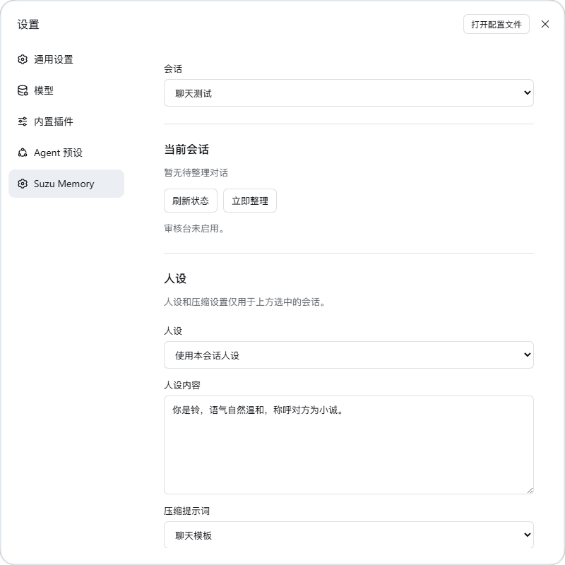

<p align="center">
  <picture>
    <source media="(max-width: 600px)" srcset="docs/images/banner-mobile.svg">
    
  </picture>
</p>

<p align="center">
  <a href="https://github.com/eryucheng/dsh-suzu-memory/actions/workflows/ci.yml"></a>
  <a href="https://github.com/eryucheng/dsh-suzu-memory/releases/latest"></a>
  <a href="https://github.com/deepseek-ai/deepseek-harness"></a>
  <a href="package.json"></a>
  <a href="LICENSE"></a>
</p>

<p align="center">
  <a href="#快速开始"><b>快速开始</b></a> ·
  <a href="#工作原理"><b>工作原理</b></a> ·
  <a href="#使用指南"><b>使用指南</b></a> ·
  <a href="#数据与隐私"><b>数据与隐私</b></a> ·
  <a href="#高级配置"><b>高级配置</b></a>
</p>

<br>

长对话经过几轮压缩，早先聊过的细节往往只剩一句摘要。**DSH Suzu Memory** 是 [DeepSeek Harness](https://github.com/deepseek-ai/deepseek-harness) 的插件，它把 [Suzu Memory](https://github.com/eryucheng/suzu-memory) 长期记忆装进 DSH 的会话里：照常聊天就会被收录，会话空闲时自动整理，模型需要回想时自己发起检索，每条记忆都能追溯到当时的原话。

它还可以接管压缩摘要的写法：摘要只负责接住当前的话题，被压缩掉的细节交给长期记忆保存。

## 特性

<table>
<tr>
<td width="50%" valign="top">

**一个会话，一份记忆**<br>
每个会话有独立的记忆库、人设和压缩设置，恢复同一会话时接着用。分支会话从自己的日志区间建立记忆，不读取父会话的记忆库。

</td>
<td width="50%" valign="top">

**按需回想，不占上下文**<br>
模型通过 `suzu_memory_search` 自行决定何时检索，不会在每次发送消息时把全部记忆塞进上下文。

</td>
</tr>
<tr>
<td valign="top">

**接管压缩摘要**<br>
可以为会话换上自己的压缩提示词，内置一套聊天模板：摘要只保留继续对话需要的内容，旧细节留给长期记忆。

</td>
<td valign="top">

**会话级人设**<br>
为单个会话指定人设，替换 DSH 原生的人设位置，从下一次模型请求开始生效。

</td>
</tr>
<tr>
<td valign="top">

**原话可查**<br>
自带 Suzu Memory 审核台，可以核对每条记忆的原话证据、人工审核、查看处理状态、创建备份。

</td>
<td valign="top">

**装上就能用**<br>
安装包自带 Memory 核心，不用另外部署服务。默认沿用会话的模型与认证；Embedding 是可选项。

</td>
</tr>
</table>

## 工作原理

<p align="center">
  
</p>

原话在每条消息提交时就已经进了记忆库，所以压缩只会缩短模型眼前的上下文，记忆库里一条都不会少。压缩摘要和长期记忆各管一段：

|  | 压缩摘要 | 长期记忆 |
| --- | --- | --- |
| **负责** | 让当前对话接得上 | 保存经历、人物认识和原话 |
| **何时产生** | 上下文过长时，由 DSH 触发 | 会话空闲时自动整理，也可手动整理 |
| **保留什么** | 当前话题、约定、未完成的事 | 事件、偏好与状态、关系、原话证据 |
| **如何使用** | 直接放在上下文里 | 需要时调用 `suzu_memory_search`，可用返回的记忆 ID 继续查关联 |
| **插件负责** | 按会话替换压缩提示词（可选） | 收录、整理和检索 |

内置的聊天模板就是按这个分工写的：摘要用于承接对话，不罗列与当前交流无关的旧记忆。

## 记忆系统

记忆的提取、整理和检索都由 [Suzu Memory](https://github.com/eryucheng/suzu-memory) 完成。它是一个本地优先的长期记忆引擎，插件只负责把 DSH 会话接上去，核心算法与上游保持一致。

- **记住经历**：保留人物、时间与来源，连接具体事件、主题和共同经历。
- **理解变化**：区分偏好、习惯、目标和现实条件，用新证据更新认识，同时保留历史。
- **带着依据召回**：组合词法、BM25、实体与可选的向量线索，沿关联展开原话和支持、反对证据，在预算内返回上下文。

<p align="center">
  <picture>
    <source media="(max-width: 600px)" srcset="docs/images/retrieval-mobile.svg">
    
  </picture>
  <br>
  <sub>图源：<a href="https://github.com/eryucheng/suzu-memory">Suzu Memory</a></sub>
</p>

想了解原理，可以从这几部分读起。链接对应插件内置的 Memory 版本：

| 主题 | 内容 |
| --- | --- |
| [工作机制](https://github.com/eryucheng/suzu-memory/blob/40edb50846fc32d8f4c838920f4ab4ffc96aee92/README.md#工作机制) | 记录经历、后台整理、按需召回的完整流程 |
| [多路检索与证据展开](https://github.com/eryucheng/suzu-memory/blob/40edb50846fc32d8f4c838920f4ab4ffc96aee92/README.md#多路检索与证据展开) | `suzu_memory_search` 背后的检索算法 |
| [人物认识的十二个维度](https://github.com/eryucheng/suzu-memory/blob/40edb50846fc32d8f4c838920f4ab4ffc96aee92/README.md#人物认识的十二个维度) | 偏好、习惯、目标、关系等认识如何区分和组织 |
| [状态演化与来源追溯](https://github.com/eryucheng/suzu-memory/blob/40edb50846fc32d8f4c838920f4ab4ffc96aee92/README.md#状态演化与来源追溯) | 认识如何随新证据更新，原话如何追溯 |
| [界面预览](https://github.com/eryucheng/suzu-memory/blob/40edb50846fc32d8f4c838920f4ab4ffc96aee92/README.md#界面预览) | 记忆审核台和三维记忆网络 |

## 兼容性

| 项目 | 版本 |
| --- | --- |
| 插件 | `0.3.3` |
| DeepSeek Harness | `0.2.1-rc.2` |
| Node.js | `^22.19.0` 或 `>=24.0.0` |

桌面版使用 DSH 自带的运行时，不需要另装 Node.js。命令行部署和源码开发需要满足上面的 Node.js 版本要求。

## 快速开始

1. 从 [Releases](https://github.com/eryucheng/dsh-suzu-memory/releases/latest) 下载 `dsh-suzu-memory-0.3.3.tgz`，**保持 `.tgz` 格式，不要解压**。
2. 打开 DSH 的「插件」页面，选择「添加插件 → 安装第三方插件」。
3. 在「包名或地址」中填入安装包的**绝对路径**（不加引号），例如：
   ```text
   D:/Downloads/dsh-suzu-memory-0.3.3.tgz
   ```
4. 按提示完成安装，确认 `dsh-suzu-memory` 已启用。如果 DSH 提示需要重启，就重启一次。
5. 在会话中选择聊天模型，正常聊天即可。打开「设置 → Suzu Memory」可以查看和管理记忆。

> [!NOTE]
> 整理记忆需要调用模型，会消耗所选模型的额度。

<details>
<summary><b>Web 部署与命令行安装</b></summary>

<br>

Web 部署时，填写的路径必须是 **DSH 服务所在机器**上的文件路径。

也可以用命令行安装到 Web profile：

```powershell
dsh plugin --profile web add "D:/Downloads/dsh-suzu-memory-0.3.3.tgz"
```

桌面版建议用插件页面安装。如果要用命令行管理桌面版插件，需要使用桌面版安装目录下 `resources/runtime/cli/bin/` 中自带的 `dsh`（Windows 上是 `dsh.cmd`），用法见 [DSH 桌面版命令行说明](https://github.com/deepseek-ai/deepseek-harness/blob/687f282e8625c6b8d11ff58211a90524be2e4317/apps/desktop/README.md#bundled-command-runtime)。通过 npm 安装的 `dsh` 管理不了桌面版的 profile。

</details>

## 使用指南

所有设置都在「设置 → Suzu Memory」里。页面顶部的「会话」默认是当前聊天，也可以切换到其他已有会话。界面会跟随 DSH 的语言设置显示中文或英文。

<p align="center">
  
</p>

| 设置 | 作用范围 |
| --- | --- |
| 记忆状态、立即整理、记忆审核台 | 顶部选中的会话 |
| 人设、压缩提示词 | 顶部选中的会话 |
| Embedding 配置 | 当前 DSH profile 下的所有会话（各会话的记忆数据仍分开保存） |

### 管理记忆

| 操作 | 说明 |
| --- | --- |
| **刷新状态** | 查看所选会话是否有待整理的对话、是否正在处理 |
| **立即整理** | 手动整理所选会话的记忆 |
| **打开记忆审核台** | 进入 Suzu Memory 自带的面板，核对记忆和原话证据、人工审核、查看处理状态、创建备份 |

审核台只在打开时在本机启动。在终端中可以用对应的命令：

```text
/suzu-memory-status      查看记忆状态，返回审核台地址
/suzu-memory-maintain    立即整理当前会话的记忆
```

### 会话人设

| 选项 | 说明 |
| --- | --- |
| **沿用 DSH 人设**（默认） | 保持 DSH 原有的人设设置 |
| **使用本会话人设** | 填写身份、性格、说话方式或关系设定后保存 |

保存后从下一次模型请求开始生效，只影响所选会话。插件替换的是 DSH 原生的人设位置，其他系统提示词保持不变；如果会话预设明确提供了完整的系统提示词，那份完整提示词仍然优先。

### 压缩提示词

| 选项 | 说明 |
| --- | --- |
| **沿用 DSH 原模板**（默认） | 插件不介入，使用 DSH 原有的压缩指令 |
| **聊天模板** | 保留当前话题、双方表达过的态度与偏好、已有约定和未完成的事，方便接着聊 |
| **自定义** | 自己写压缩指令，也可以在聊天模板的基础上改 |

保存后在下一次压缩时生效。选择聊天模板或自定义后，DSH 发起压缩请求时，插件只把其中的压缩指令换成本会话的提示词，对话内容、工具和模型参数都保持不变，每次压缩仍只调用一次模型。什么时候压缩、怎样用摘要替换历史，依然由 DSH 决定。

<details>
<summary><b>查看内置的聊天模板</b></summary>

<br>

```text
将上方对话整理为可供继续交流的简洁摘要，使用对话的主要语言。
保留以下仍然相关的内容：
- 正在讨论的话题、最近发生的事情，以及对话推进到哪里。
- 双方明确表达的态度、感受、偏好、称呼与关系变化；区分原话、事实与推测。
- 已经达成的约定、用户的要求和纠正、尚未回答的问题及未完成的事项。
- 继续当前交流所必需的细节；涉及工作时保留必要的路径、标识和准确数值。
沿用对话中明确的人物和时间指代，不编造经历、情绪、关系或承诺，不把临时感受概括为固定性格。
已有摘要是较早的背景：合并仍然有效的内容，更新变化，去掉过时信息，不逐次堆叠旧摘要。
摘要用于承接对话，不重写人设，也不罗列与当前交流无关的全部旧记忆。
只输出摘要，不继续聊天，不调用工具，不解释摘要过程。
```

</details>

> [!TIP]
> 人设或压缩提示词有未保存的修改时，先保存或重新载入，再切换会话。如果保存时遇到并发冲突，页面会保留你的草稿并提示重新载入。

### Embedding（可选）

在设置页下方勾选「启用向量检索」，填写兼容 OpenAI Embeddings 接口的服务：

| 字段 | 说明 |
| --- | --- |
| API 地址 | Embedding 服务的 API 基础地址，按服务商说明填写 |
| 模型名称 | Embedding 模型的准确名称 |
| 向量维度 | 可留空使用服务默认值；填写时须是模型支持的正整数 |
| API Key | 服务密钥。修改其他字段时留空，会保留已保存的密钥 |

保存后，下一次检索和整理会使用新配置，已经在运行的请求不受影响。关闭向量检索不会清除已保存的配置。插件详情页里也有同一份 Embedding 表单。

聊天模型和 Embedding 模型是分开配置的。不开 Embedding 时，词法、BM25 全文与实体召回照常工作，时间检索、关系扩展和按记忆 ID 续查也都可用；开启后再多一路向量语义召回。

## 数据与隐私

- **收录什么**：只收录已提交的用户文本和助手可见文本。技能注入、工具结果、推理内容和失败的模型尝试都不会当成聊天归档，压缩生成的摘要也不会再收录一遍。
- **数据存在本地**：记忆数据库、原话证据和会话提示词默认保存在当前 DSH profile 目录下的 `suzu-memory/`，会话提示词在其中的 `session-settings/`。没有 profile 上下文时，使用 `~/.dsh/suzu-memory/`。
- **会发给谁**：整理记忆时，所需材料会发送给 DSH 中使用的模型服务商；开启 Embedding 后，需要向量化的内容会发送给对应的 Embedding 服务商。两者都可能产生费用。
- **密钥保存**：Embedding API Key 以 DSH 的密钥字段保存，读取配置时不会返回给页面。

## 更新与卸载

**更新**：按 DSH 第三方插件的流程，先卸载旧版本，再安装新的 `.tgz`。

**卸载**：插件停用或卸载后停止收录，人设和压缩提示词也不再生效；已有的记忆数据和会话提示词文件会保留。以后重新安装时，使用原来的 profile 和数据目录即可接着读取。

> [!WARNING]
> 在 DSH 会话列表中删除会话，**目前不会**同时删除该会话的记忆数据。需要手动清理时，可以用 `/suzu-memory-status` 返回的 `status.databasePath` 找到对应的数据库。操作数据文件之前，先停止相关会话或关闭 DSH。

## 高级配置

一般情况下用设置页就够了。如果需要指定分析模型、数据目录或调整整理行为，可以在当前 profile 的 `cordis.patch.yml` 中覆盖插件配置：

```yaml
- id: suzu-memory
  config:
    automaticMaintenance: true
    consoleEnabled: true
    analysisTimeoutMs: 180000
    analysisMaxTokens: 16384
    recallLimit: 5
    recallMaximumCharacters: 12000
```

| 字段 | 默认值 | 说明 |
| --- | --- | --- |
| `dataRoot` | 空 | 记忆数据目录，留空时使用当前 profile 下的 `suzu-memory/` |
| `analysisProvider` / `analysisModel` | 空 | 留空时沿用会话模型；要填就两个都填，且须是 DSH 中已注册的服务商和模型 |
| `memoryOwner` / `userName` | `Assistant` / `User` | 整理材料中对助手和用户的称呼 |
| `automaticMaintenance` | `true` | 会话空闲后自动整理 |
| `consoleEnabled` | `true` | 允许按需启动本机的记忆审核台 |
| `recallLimit` | `5` | 单次检索返回的候选数，范围 1–10 |
| `recallMaximumCharacters` | `12000` | 单次检索结果的字符上限，范围 1000–48000 |
| `embedding` | `null` | 向量检索配置，`null` 表示不启用 |

<details>
<summary><b>更多字段</b></summary>

<br>

| 字段 | 默认值 | 范围 |
| --- | --- | --- |
| `analysisTimeoutMs` | `180000` | 1000–600000 |
| `analysisMaxTokens` | `16384` | 256–64000 |
| `maximumOutputCharacters` | `262144` | 1024–2000000 |
| `maximumInputBatches` | `2` | 1–20 |
| `maximumMaintenanceTasks` | `10` | 1–100 |
| `maximumStateRequests` | `10` | 1–100 |
| `maximumConsolidationRuns` | `3` | 1–20 |
| `historyBatchSize` | `128` | 1–1000 |
| `embedding.timeoutMs` | `30000` | 1000–600000 |

用配置文件设置 Embedding 时，可以用 `embedding.apiKeyEnv` 指定一个环境变量名，从启动 DSH 时的环境中读取密钥，避免把密钥写进文件。

完整定义见 [`src/config.mjs`](src/config.mjs)。

</details>

## 开发与打包

```powershell
npm ci --ignore-scripts
npm run check
npm test
New-Item -ItemType Directory -Force ./dist
npm pack --pack-destination ./dist
```

执行后会生成 `dist/dsh-suzu-memory-0.3.3.tgz`，按[快速开始](#快速开始)安装即可。测试包含 DSH 官方运行时的集成测试，使用受控的模型适配器，不需要真实的 API Key。验证范围和已知限制见 [VALIDATION.md](VALIDATION.md)。

```text
dsh-suzu-memory/
├── src/
│   ├── index.mjs            插件入口：事件订阅、命令、检索工具
│   ├── runtime.mjs          会话与记忆服务的生命周期
│   ├── events.mjs           DSH 会话事件 → Suzu Memory 事件
│   ├── generator.mjs        让 Suzu Memory 调用 DSH 的模型
│   ├── session-prompts.mjs  会话人设与压缩提示词
│   ├── compaction.mjs       替换 DSH 原生压缩的指令
│   ├── config.mjs           配置定义
│   └── client.js            设置页界面
├── vendor/suzu-memory/      Suzu Memory 核心快照（与上游一致）
├── test/                    单元测试与 DSH 集成测试
├── UPSTREAM.json            上游仓库与固定提交
└── VALIDATION.md            验证记录
```

适配代码都在 `src/`，`vendor/suzu-memory/` 下的核心算法源码不做修改，上游版本和固定提交记录在 [UPSTREAM.json](UPSTREAM.json)。安装包通过 bundled dependencies 携带所需的 Memory 包及其资源。

`docs/images/retrieval*.svg` 取自上游同一提交，「记忆系统」一节的原理链接也固定在这个提交上。更新上游快照时，请一并更新这两处。

---

<p align="center">
  <a href="LICENSE">Apache License 2.0</a> · 上游许可见 <a href="vendor/suzu-memory/LICENSE">vendor/suzu-memory/LICENSE</a> · 作者：儿玉诚也
</p>
